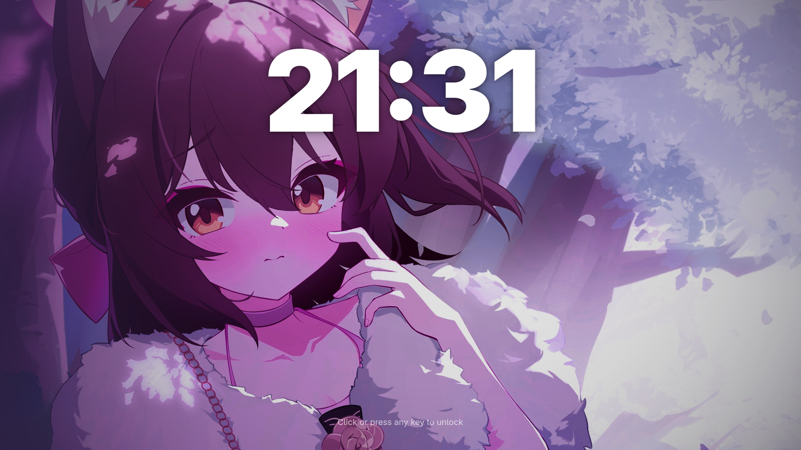

# gdm-sddm-izuna-theme

<p align="center">
  
</p>

A custom SDDM theme styled after GNOME's GDM, written from scratch in plain QML, with a massive clock lock screen and a blurred login screen.

## Features

- Lock screen with a large clock. Click or press any key to unlock.
- Blurred login screen with avatar, password field, session picker and power menu.
- Custom icons, accent color, font and clock shadow, all set in `theme.conf`.

## Requirements

- SDDM (Qt6)
- `qt6-declarative`
- `adwaita-fonts` (the theme uses Adwaita Sans)

On Arch-based distros:

```
sudo pacman -S sddm qt6-declarative adwaita-fonts
```

## Install

```
git clone https://github.com/arch2kx/gdm-sddm-izuna-theme.git
cd gdm-sddm-izuna-theme
./install.sh /path/to/your/wallpaper.png
```

This copies the theme to `/usr/share/sddm/themes/gdm-style` and sets it as the current theme in `/etc/sddm.conf.d/10-theme.conf`.

## Test without logging out

```
./test.sh /path/to/your/wallpaper.png
```

## Customize

Edit `theme.conf` for the font, accent color, UI scale, clock shadow and icon sizes. The icons live in `assets/` (`usericon.png`, `settingsicon.png`, `powericon.png`, `backicon.png`). Swap them for your own. The Izuna wallpaper from the screenshots is not included. It is fan art that I don't own and edited for this theme. To use a wallpaper, put it at `assets/wallpaper.png`. Without one, the theme falls back to a plain GDM-style background (`solidColor` in `theme.conf`).

## Troubleshooting

**The old theme still shows.** SDDM reads `/etc/sddm.conf` after everything in `/etc/sddm.conf.d/`, so a `Current=` line there overrides this theme. `install.sh` updates that line for you and keeps a backup at `/etc/sddm.conf.bak`. Log out or restart SDDM for the change to apply.

**The login screen is laggy with a 4K external monitor.** Some 4K monitors only offer 24 to 30 Hz in SDDM's X11 session, which throttles the whole greeter to that rate even when the GPU is idle. Run `grep Modeline /var/log/Xorg.0.log` and check whether a 4K output tops out below 50 Hz. If it does, set that output to 1080p at 60 Hz in the script that `DisplayCommand` points to (under `[X11]` in an SDDM config file), for example `xrandr --output DP-1 --mode 1920x1080 --rate 60`. On a hybrid GPU laptop, rendering the greeter on the NVIDIA GPU did not help in testing.

## AI Disclosure

Parts of this theme were written with help from Claude (Anthropic).

The design was tweaked by hand to stay close to GDM's look.

## License

GPL-3.0. See `LICENSE`.
